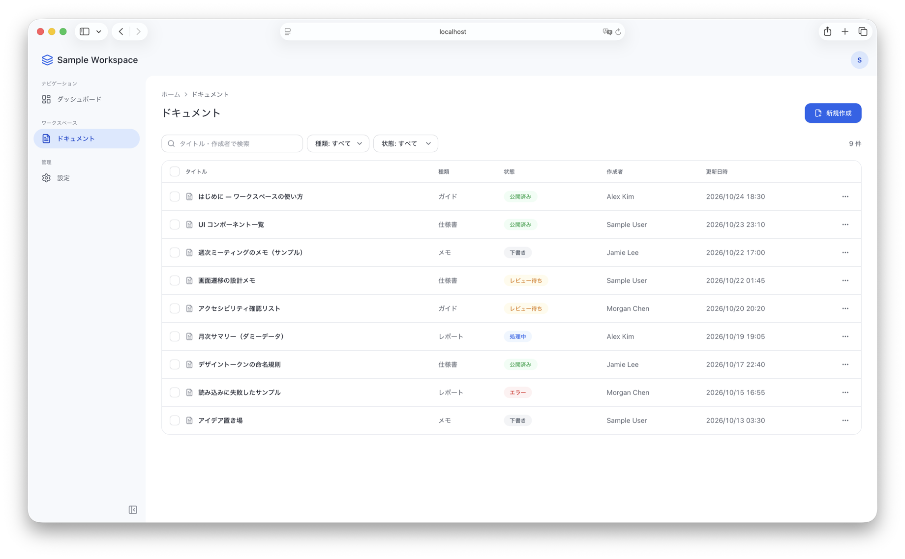
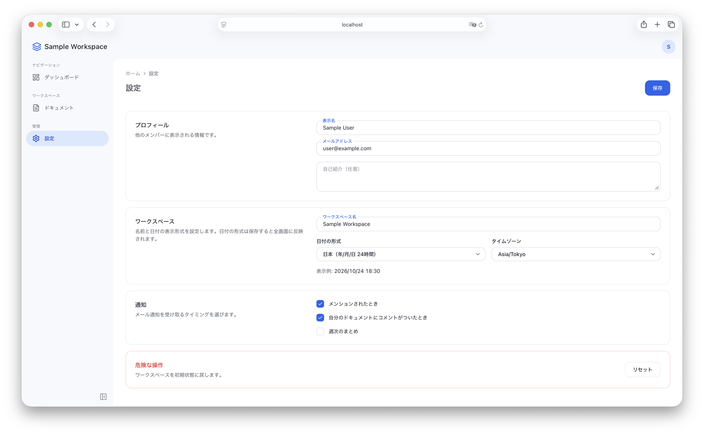

# Workspace UI Template

[日本語](README.md) | English

A frontend template for admin dashboards, built with Vite + React + TypeScript + Tailwind CSS v4.
All data and text shown on screen are fictional samples. No API or backend is included.

The UI labels are in Japanese. To change them, edit `src/app.config.ts` and the page components under `src/pages/`.


| Documents | Settings |
| --- | --- |
|  |  |

## Setup

Requires Node.js 22.22.2+ (22.x), 24.15.0+ (24.x), or 26+ (see `engines` in `package.json`). Node.js 24 LTS is recommended and is specified in `.nvmrc`.

```bash
nvm use          # switch to Node.js 24 from .nvmrc
npm install
npm run dev      # http://localhost:5173
npm run test     # interaction tests (Vitest + Testing Library)
npm run check    # type check + lint + tests
npm run build    # production build (dist/)
```

## Making it your own app

### 1. Change the app name and logo

Edit `name`, `description`, and `logo` in `src/app.config.ts`. At build time, `name` and `description` are also inserted into the `<title>` and meta description of `index.html`. Replace `public/favicon.svg` to change the favicon.

### 2. Add a page

1. Create a page component in `src/pages/`
2. Add an item (`label`, `href`, `icon`) to `navigation` in `src/app.config.ts`. Pick an icon from [lucide-react](https://lucide.dev/icons/)
3. Add the `href` and the page to `pageByPath` in `src/routes.tsx`

If you forget either step 2 or step 3, you get a type error, so the navigation and pages never get out of sync. Build pages from the components in `src/components/`, such as `PageHeader` and `Card`, to keep the look consistent.

### 3. Remove the sample pages

The data on screen comes from the fictional samples in `src/data/sample.ts`. When you no longer need them, remove the following:

- Documents page: delete `src/pages/documents/` and remove `/documents` from `navigation` and `pageByPath`
- Dashboard content: replace `src/pages/DashboardPage.tsx` with your own page
  - The dashboard's "Open documents" button (ドキュメントを開く) navigates to `/documents`. If you remove only the Documents page, this button leads to the 404 page. This is not a type error, so `npm run check` will not catch it. Remove the button or change its destination as well
- Sample data: `CURRENT_USER` is also used in `Header.tsx` and `SettingsPage.tsx`. Replace it with the signed-in user's information, then delete `src/data/sample.ts`
- Tests: rewrite or delete `src/pages/documents/DocumentsPage.test.tsx` and `src/context/DisplaySettings.test.tsx`, which uses the Documents page

Afterwards, run `npm run check` to make sure no type errors or broken tests remain.

### 4. Change colors, corner radii, and shadows

Design tokens live in `@theme` in `src/index.css`. For example, changing `--color-brand` and `--color-brand-hover` updates the brand color of buttons and other elements. The color of the selected item in the sidebar is set separately by `--color-nav-active` and `--color-nav-ink`, so change those along with the brand color.

ESLint reports an error for colors and shadows that are not tokens (such as `bg-gray-100`, `text-white`, `shadow-xl`, and `bg-[#fff]`). If you need a new color, add a token to `@theme` first.

### 5. Change how dates are displayed

The default locale and time zone for dates are set in `display` in `src/app.config.ts`. Users can change them on the Settings page.

## Deployment

`npm run build` outputs static files to `dist/`.

Routing uses `BrowserRouter`, which uses the browser URL as is. Your host must therefore serve `index.html` for requests to paths that do not exist as files (SPA fallback). Without it, opening or reloading a URL such as `/documents` directly returns a 404.

- Netlify: add `/* /index.html 200` to `public/_redirects`
- Vercel: add `rewrites` to `vercel.json` that send every path to `/index.html`
- Cloudflare Pages: treated as an SPA automatically when there is no `404.html`

## Project structure

```
src/
├── app.config.ts            # app name, logo, navigation, default date display
├── routes.tsx               # page for each navigation URL
├── main.tsx / App.tsx       # entry point and routing (react-router)
├── index.css                # design tokens (@theme)
├── components/              # reusable UI components
│   ├── AppLayout.tsx        # header + sidebar + content
│   ├── Header.tsx / UserMenu.tsx
│   ├── Sidebar.tsx          # always-visible sidebar at md and up
│   ├── MobileNav.tsx        # drawer navigation below md
│   ├── NavMenu.tsx          # menu shared by Sidebar and MobileNav
│   ├── Button.tsx / IconButton.tsx / Card.tsx / PageHeader.tsx / StatCard.tsx
│   ├── Input.tsx / Select.tsx / Textarea.tsx / Checkbox.tsx / RequiredMark.tsx
│   ├── StatusBadge.tsx / EmptyState.tsx
│   ├── Modal.tsx / SideDrawer.tsx / OverflowMenu.tsx
│   ├── ConfirmDialog.tsx    # useConfirm()
│   ├── Toast.tsx            # useToast()
│   └── NotFoundContent.tsx
├── context/
│   └── DisplaySettings.tsx  # date format and time zone (useDisplaySettings)
├── hooks/
│   └── useModalBehavior.ts  # shared dialog behavior (focus, Esc, focus trap)
├── pages/                   # sample pages (Dashboard / Settings / 404)
│   └── documents/           # Documents page
│       ├── DocumentsPage.tsx      # page that only lays out the components
│       ├── useDocumentsPage.ts    # search, filter, select, create, duplicate, delete
│       ├── DocumentToolbar.tsx    # search and filters
│       ├── DocumentTable.tsx      # table at md and up
│       ├── DocumentMobileList.tsx # card list below md
│       ├── DocumentRowMenu.tsx    # row menu shared by the table and cards
│       ├── DocumentPreview.tsx / DocumentSelectionBar.tsx / CreateDocumentForm.tsx
│       └── options.ts             # type and status options
├── data/sample.ts           # fictional sample data
└── lib/format.ts            # date formatting (takes locale and time zone as arguments)
```

## License

[MIT License](LICENSE)
