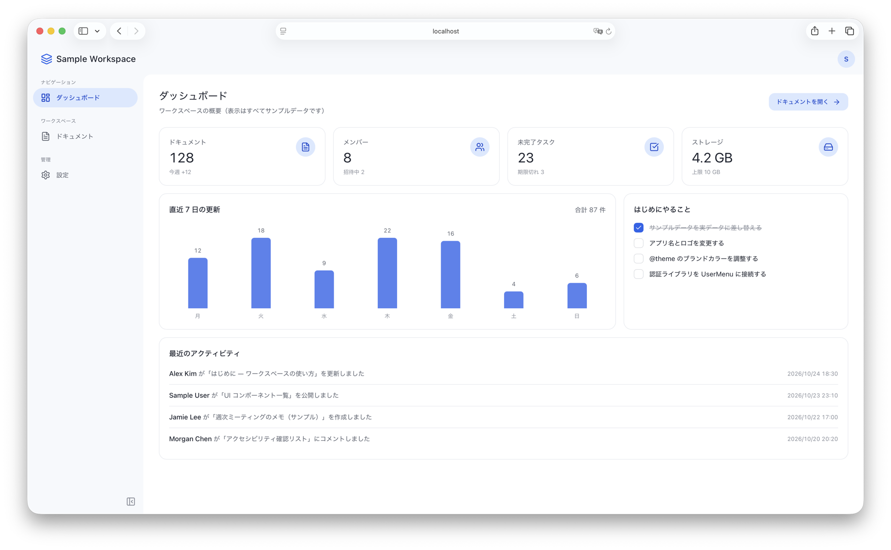

# Workspace UI Template

日本語 | [English](README.en.md)

Vite + React + TypeScript + Tailwind CSS v4 で作った、管理画面向けのフロントエンドテンプレートです。
画面に表示されるデータ・文章はすべて架空のサンプルです。API（Application Programming Interface）やバックエンドは含みません。



## セットアップ

Node.js 22.22.2 以上（22 系）、24.15.0 以上（24 系）、または 26 以上が必要です（`package.json` の `engines`）。推奨は LTS（Long Term Support、長期サポート版）の Node.js 24 です。`.nvmrc` にも Node.js 24 を指定しています。

```bash
nvm use          # .nvmrc の Node.js 24 に切り替える
npm install
npm run dev      # http://localhost:5173
npm run test     # 操作テスト（Vitest + Testing Library）
npm run check    # 型チェック + lint + テスト
npm run build    # 本番ビルド（dist/）
```

## 自分のアプリにする

### 1. アプリ名・ロゴを変える

`src/app.config.ts` の `name`・`description`・`logo` を書き換えます。`name` と `description` はビルド時に `index.html` の `<title>` と meta description にも入ります。ファビコンは `public/favicon.svg` を差し替えてください。

### 2. ページを足す

1. `src/pages/` に画面のコンポーネントを作る
2. `src/app.config.ts` の `navigation` に項目（`label`・`href`・`icon`）を足す。アイコンは [lucide-react](https://lucide.dev/icons/) から選ぶ
3. `src/routes.tsx` の `pageByPath` に、その `href` と画面を足す

2 と 3 のどちらかを忘れると型エラーになります。このため、ナビゲーションと画面の対応がずれません。各画面を `PageHeader` や `Card` など `src/components/` の部品で組み立てると、見た目がそろいます。

### 3. サンプル画面を消す

画面に出ているデータは、`src/data/sample.ts` に書いた架空のものです。不要になったら次を消してください。

- ドキュメント画面: `src/pages/documents/` を消し、`navigation` と `pageByPath` から `/documents` を外す
- ダッシュボードの中身: `src/pages/DashboardPage.tsx` を自分の画面に書き換える
  - ダッシュボードの「ドキュメントを開く」ボタンは `/documents` に移動する。ドキュメント画面だけを消すと、このボタンは 404 画面に飛ぶ。型エラーにはならず `npm run check` でも見つからないので、ボタンも消すか移動先を変える
- サンプルデータ: `CURRENT_USER` は `Header.tsx` と `SettingsPage.tsx` でも使っている。ログイン中のユーザー情報に置き換えてから `src/data/sample.ts` を消す
- テスト: `src/pages/documents/DocumentsPage.test.tsx` と、ドキュメント画面を使っている `src/context/DisplaySettings.test.tsx` を書き換えるか消す

消した後は `npm run check` で、型エラーや壊れたテストが残っていないか確認できます。

### 4. 色・角丸・影を変える

デザイントークンは `src/index.css` の `@theme` にまとまっています。たとえばブランド色は `--color-brand` と `--color-brand-hover` を変えるとボタンなどに反映されます。サイドバーで選んでいる項目の色は、`--color-nav-active` と `--color-nav-ink` で別に決めています。ブランド色と合わせて変えてください。

ESLint は、トークン以外の色や影（`bg-gray-100`、`text-white`、`shadow-xl`、`bg-[#fff]` など）を書くとエラーにします。新しい色が必要なときは、`@theme` にトークンを足してから使ってください。

### 5. 日付の表示を変える

日付表示に使う既定のロケールとタイムゾーンは `src/app.config.ts` の `display` で決めます。利用者は設定画面から変更できます。

## デプロイ

`npm run build` で `dist/` に静的ファイルを出力します。

ルーティングには `BrowserRouter`（ブラウザの URL をそのまま使う方式）を使っています。このため、ホスティング側で「存在しないパスへのリクエストにも `index.html` を返す」設定が必要です。この設定を SPA（Single Page Application）fallback と呼びます。設定しないと、`/documents` などを直接開いたり再読み込みしたりしたときに 404 になります。

- Netlify: `public/_redirects` に `/* /index.html 200` を書く
- Vercel: `vercel.json` の `rewrites` で全パスを `/index.html` に向ける
- Cloudflare Pages: 404.html がなければ自動で SPA として扱われる

## 構成

```
src/
├── app.config.ts            # アプリ名・ロゴ・ナビゲーション・日付表示の既定値
├── routes.tsx               # ナビゲーションの URL ごとの画面
├── main.tsx / App.tsx       # エントリーとルーティング（react-router）
├── index.css                # デザイントークン（@theme）
├── components/              # 再利用可能な UI 部品
│   ├── AppLayout.tsx        # ヘッダー + サイドバー + コンテンツ
│   ├── Header.tsx / UserMenu.tsx
│   ├── Sidebar.tsx          # md 以上の常時表示サイドバー
│   ├── MobileNav.tsx        # md 未満のドロワー型ナビゲーション
│   ├── NavMenu.tsx          # Sidebar と MobileNav が共有するメニュー
│   ├── Button.tsx / IconButton.tsx / Card.tsx / PageHeader.tsx / StatCard.tsx
│   ├── Input.tsx / Select.tsx / Textarea.tsx / Checkbox.tsx / RequiredMark.tsx
│   ├── StatusBadge.tsx / EmptyState.tsx
│   ├── Modal.tsx / SideDrawer.tsx / OverflowMenu.tsx
│   ├── ConfirmDialog.tsx    # useConfirm()
│   ├── Toast.tsx            # useToast()
│   └── NotFoundContent.tsx
├── context/
│   └── DisplaySettings.tsx  # 日付の形式とタイムゾーン（useDisplaySettings）
├── hooks/
│   └── useModalBehavior.ts  # ダイアログ共通の振る舞い（フォーカス・Esc・フォーカストラップ）
├── pages/                   # サンプル画面（Dashboard / Settings / 404）
│   └── documents/           # ドキュメント画面
│       ├── DocumentsPage.tsx      # 部品を並べるだけのページ本体
│       ├── useDocumentsPage.ts    # 検索・絞り込み・選択・作成・複製・削除
│       ├── DocumentToolbar.tsx    # 検索とフィルター
│       ├── DocumentTable.tsx      # md 以上の表
│       ├── DocumentMobileList.tsx # md 未満のカード一覧
│       ├── DocumentRowMenu.tsx    # 表とカードで共有する行メニュー
│       ├── DocumentPreview.tsx / DocumentSelectionBar.tsx / CreateDocumentForm.tsx
│       └── options.ts             # 種類と状態の選択肢
├── data/sample.ts           # 架空のサンプルデータ
└── lib/format.ts            # 日付フォーマット（ロケールとタイムゾーンを引数で受け取る）
```

## ライセンス

[MIT License](LICENSE)
